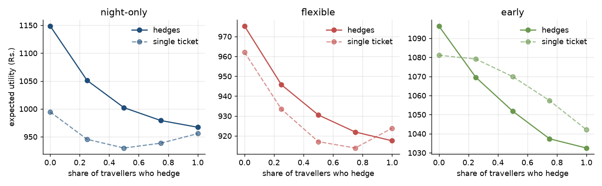
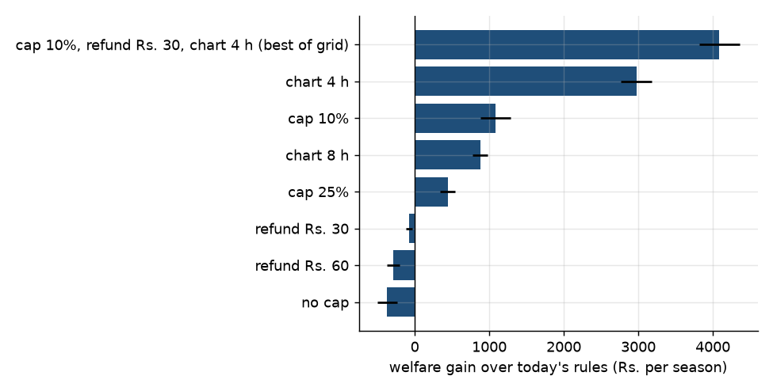
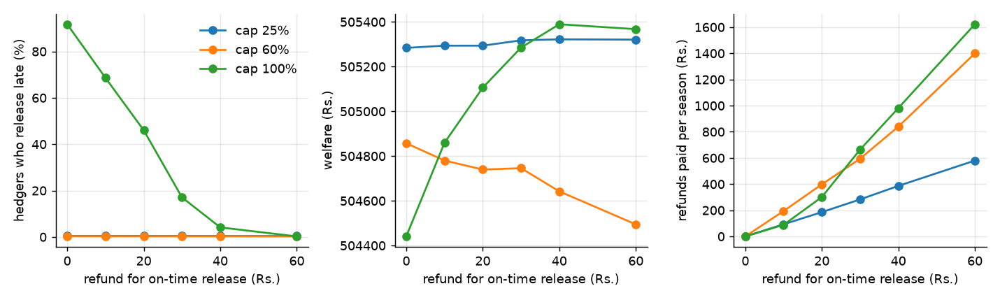
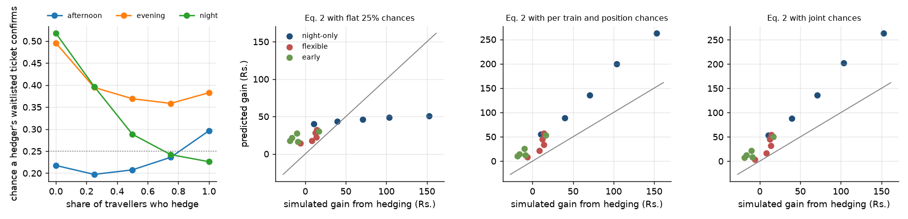
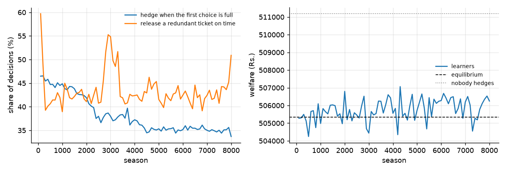
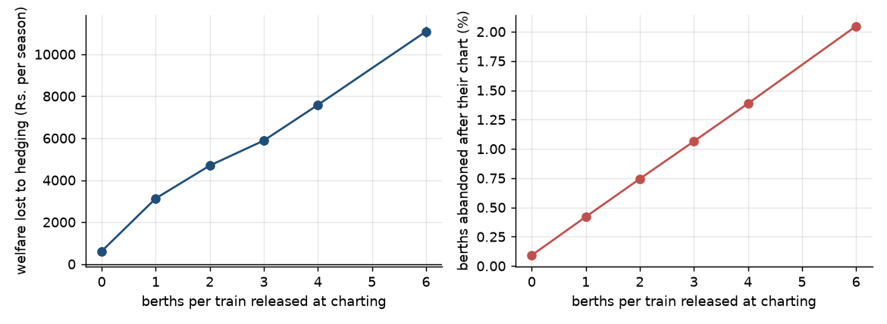

# Hold Both, Release Late?

Strategic waitlist hedging on Indian Railways. CS329 (Foundations of AI), Group 36.

A waitlisted ticket no longer lets you board a reserved coach, so travellers book
waitlisted tickets on several trains and keep whichever confirms. We model this as a
game between travellers, with the railway setting the rules, and ask whether the harm
to other travellers comes from hedging itself or from releasing unneeded tickets late,
and which rule helps most: a tighter waitlist cap, a refund for releasing early, or a
different chart time.

The write-up is [report/report.pdf](report/report.pdf). The short version:

- Hedging is a prisoner's dilemma for travellers with a strong favourite train, and
  everyone else loses from it. In equilibrium it costs about 1.2% of welfare.
- If everybody hedged and released late, 58% of the loss would come from hedging itself
  and 42% from late release. Under today's rules nobody releases late, because the
  cancellation charges already punish it.
- Of the three rules, a later chart helps most. A tighter cap helps a little and turns
  more people away, and the refund only matters when there is no cap.
- The harm depends on how many berths reach the waitlist only at charting.

## Results

All numbers are averages over 600 simulated seasons; the CSV behind every figure is in
`results/`.

**Hedging is a prisoner's dilemma for night-only travellers** (`q1_dilemma`). Each gains
from a second ticket whatever the others do, and all of them end up worse off.



**Where the loss comes from** (`q2_decomposition`).

| Population | Welfare (Rs.) |
|---|---|
| Planner (upper bound) | 555,615 |
| Nobody hedges | 510,745 |
| Equilibrium (23% hedge) | 504,858 |
| Everybody hedges, releases on time | 504,380 |
| Everybody hedges, releases late | 499,733 |

**The railway's rules** (`ranking`). Welfare change against today's rules, with the
travellers' equilibrium re-solved under each rule.



**A refund for early release only matters without a cap** (`q4_refund`). Refunds are
transfers, so they are left out of welfare and reported separately; the table also gives
the railway's own objective, welfare minus refunds, under which a Rs. 40 refund only
breaks even.



**Eqs. 2 and 3 against the simulation** (`rule_check`). Confirmation chances are not
fixed and not independent across trains: two waitlisted tickets of one traveller both
confirm up to two and a half times as often as the product rule says. Eq. 2 still
misjudges the gain from hedging when it is given the measured chances, with or without
the independence assumption. The chances are measured on a small group of hedgers who
hold every ticket to the chart, so that early cancellations do not bias them.



**Learning travellers** (`learn`) end up close to the equilibrium's welfare with less
hedging, and so do travellers who follow Eqs. 2 and 3. The same table has the fixed
baselines.



**The size of the harm depends on berths released at charting** (`chart_release`).



## The market

The market in `config.yaml` follows the rules in force in late 2026: waitlists capped at
60% of capacity for AC classes, the first chart 10 hours before departure, and refunds in
windows of 72, 24 and 8 hours.

## Layout

```
config.yaml       the market: trains, fares, charges, traveller types
hedging/
  market.py       one booking season: bookings, waitlists, charts, cancellations
  strategies.py   how travellers book and when they release
  rules.py        Eqs. 2 and 3 of the proposal, and the chances they need
  equilibrium.py  best-response iteration over traveller types
  learning.py     travellers who learn by Monte Carlo control
  planner.py      welfare-maximising benchmark
  metrics.py      welfare, empty berths, turned away, ...
  simulate.py     run many seasons in parallel
experiments/      one script per research question
results/          the tables and figures the report uses
report/           the report (LaTeX source and PDF)
tests/            small markets worked out by hand
```

## Running it

Python 3.10 or newer.

```bash
python -m venv .venv && source .venv/bin/activate
pip install -r requirements.txt

pytest                                  # 24 tests, under a second
python -m experiments.q1_dilemma        # one question
python -m experiments.run_all           # everything, about 15 minutes on a laptop
```

Each experiment prints its table and writes a CSV and a figure to `results/`.

| Script | Question |
|---|---|
| `q1_dilemma` | Is hedging a prisoner's dilemma? |
| `q2_decomposition` | How much of the loss is hedging, how much is late release? |
| `q3_cap` | Does a tighter cap help, or start a race for slots? |
| `q4_refund` | How large must an early-release refund be, and what does it cost? |
| `q5_chart` | Does an earlier chart leave more berths empty? |
| `ranking` | Which rules are best for the railway, searching all combinations? |
| `rule_check` | Do the proposal's Eqs. 2 and 3 match the simulation, with fixed, measured and joint confirmation chances? |
| `learn` | Do learning travellers end up at the equilibrium? |
| `equilibrium_check` | Is the equilibrium the same from other starting points and with one deviating traveller, and how much could each type still gain? |
| `chart_release` | How much of the harm depends on berths released at charting? |
| `sensitivity` | Do the findings survive other parameter values? |

All scripts take `--seasons N` (seasons simulated per data point; the default of 600 is
what the report uses)
and `--config path.yaml` to run a different market. Results are reproducible: season
`k` always draws the same travellers.

## Changing the market

Everything is in `config.yaml`. To try another policy from Python:

```python
from hedging import config, equilibrium
from hedging.simulate import evaluate

cfg = config.load().with_policy(cap=0.25, refund=30, chart=4)
profile = equilibrium.solve(cfg)["profile"]
print(evaluate(cfg, profile, seeds=range(200))["welfare"])
```

To rebuild the report after re-running the experiments:

```bash
cd report && latexmk -pdf -outdir=build report.tex && cp build/report.pdf .
```

## Team

| Member | Task |
|---|---|
| Akshit Chhabra | Model design, booking simulator, welfare accounting, policy experiments |
| Kunal Chandola | Equilibrium solver and its checks, search over the railway's rules |
| Miloni Thakkar | Check of Eqs. 2 and 3, policy facts, report |
| Devarshi Savalgi | Learning travellers, their comparison with the equilibrium and the rule-followers, tests |
